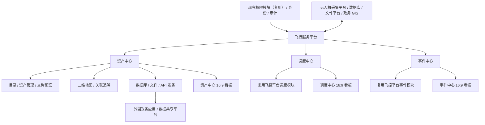
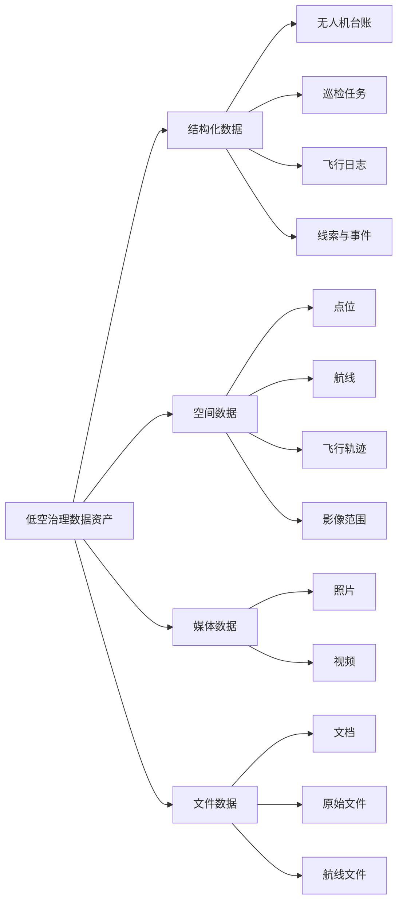
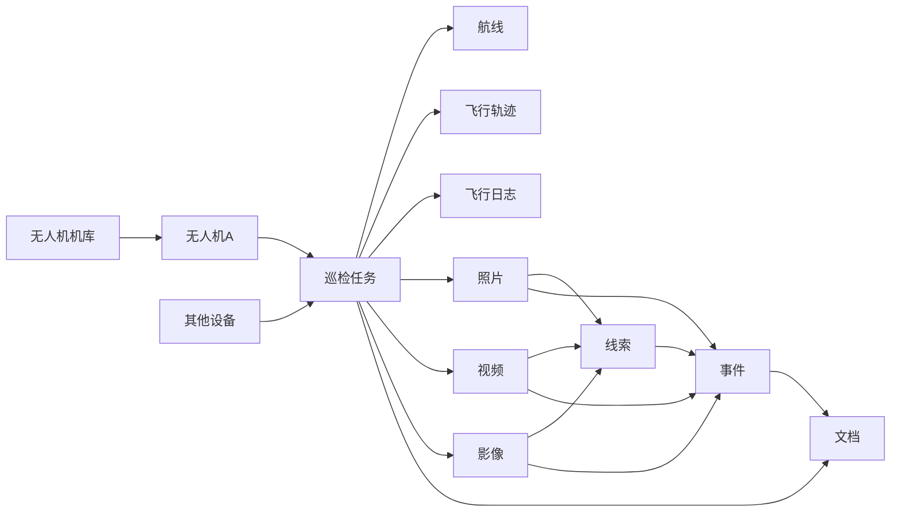
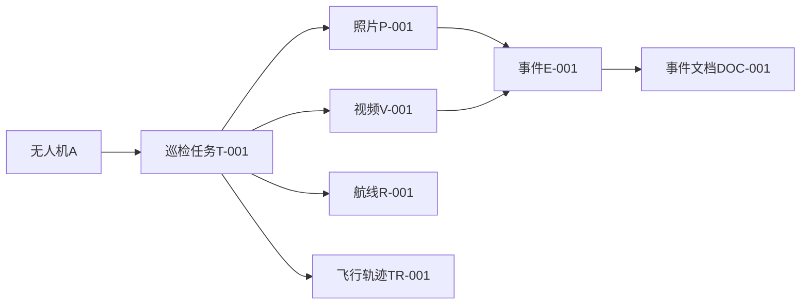
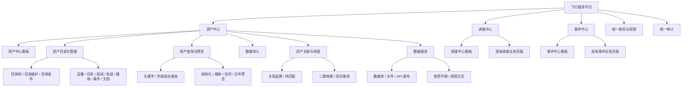
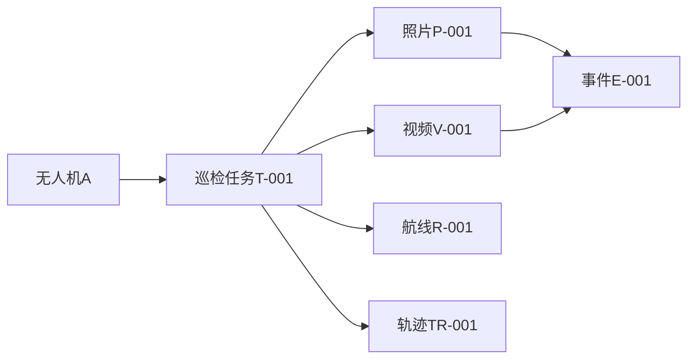
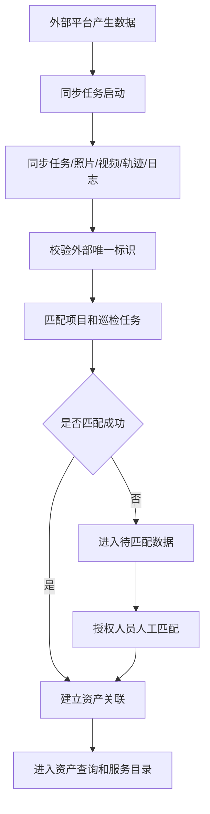
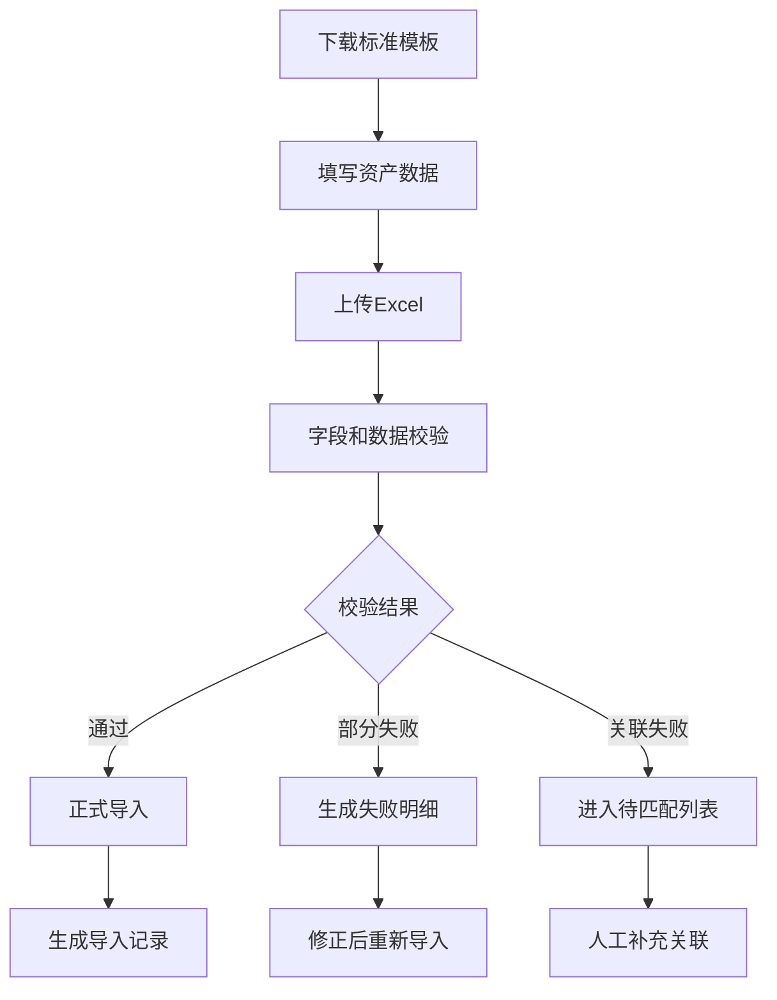
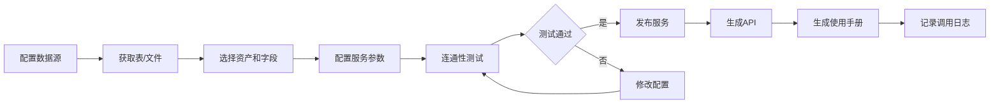

# 低空治理飞行服务平台

## 产品需求说明书 PRD V2.0

> **项目属性：** 政务项目平台
> **产品定位：** 面向低空治理的飞行服务平台，包含资产中心、调度中心和事件中心
> **编制日期：** 2026-10-09
> **文档状态：** 需求变更版

---

## 1. 文档说明

本文档基于 V1.0《低空治理数据资产服务子系统》需求基线及本次产品范围变更编制。平台由资产中心、调度中心和事件中心组成；资产中心既有需求和功能保持不变，调度中心与事件中心复用现有飞控平台模块，并为三个模块分别建设大屏看板。

本文档用于指导：

- 产品设计
- 交互与 UI 设计
- 技术架构设计
- 接口设计
- 数据模型设计
- 项目需求评审
- 后续开发和测试

### 1.1 需求来源

| 来源 | 用途 |
|---|---|
| V1.0《低空治理数据资产服务子系统》 | 资产中心功能需求基线，本版不调整其功能范围 |
| 飞控系统现有调度中心、事件中心 | 调度与事件模块复用依据，以现有模块页面和业务能力为准 |
| reference/UI 参考截图 | 平台管理页和大屏看板的视觉风格、模块布局参考 |
| 本次需求变更 | 平台更名、三模块整合、各模块 16:9 大屏要求 |

---

## 2. 产品定位

飞行服务平台面向低空城市治理场景，整合资产中心、调度中心和事件中心，为低空飞行作业提供资产管理、飞行任务调度、事件管理和综合态势展示能力。

资产中心围绕无人机、机库、设备、巡检任务、航线、飞行轨迹、飞行日志、照片、视频、影像、线索、事件和文档等数据资源，提供统一目录、资产维护、查询预览、二维空间展示、资产关联追溯及数据服务发布能力。调度中心和事件中心复用飞控平台现有模块，并在飞行服务平台统一入口下提供一致的模块导航和身份权限体系。

> 平台负责模块整合和统一入口；资产中心负责数据资产服务，调度中心与事件中心分别承载既有飞行调度和事件业务能力。

---

## 3. 建设目标

1. 建设飞行服务平台统一入口，整合资产中心、调度中心和事件中心。
2. 保持资产中心现有资产目录、台账、查询、地图、关联追溯和数据服务能力。
3. 复用飞控平台现有调度中心和事件中心模块及其成熟业务页面。
4. 为资产中心、调度中心、事件中心分别提供适配大屏展示的 16:9 看板。
5. 通过统一视觉规范、模块导航、用户权限和审计机制提升平台整体一致性。
6. 支持飞行作业数据、资产数据与事件业务数据之间的协同和关联。

---

## 4. 产品范围与边界

### 4.1 本期建设范围

- 飞行服务平台统一入口及资产中心、调度中心、事件中心模块导航
- 资产中心既有功能（详细需求见第 7 至 11 章，功能范围不变）
- 复用飞控平台现有调度中心模块，包括调度看板及现有调度业务页面
- 复用飞控平台现有事件中心模块，包括事件看板及现有事件业务页面
- 三个模块各自建设一个大屏看板，设计比例为 16:9
- 数据资产目录管理
- 数据资产元数据管理
- 低空治理资产分类管理
- 单条资产新增、编辑、删除和恢复
- Excel 模板导入
- 数据资产查询和在线预览
- 多字段组合查询
- 资产关联和关系追溯
- 待匹配数据处理
- 二维地图展示和空间查询
- 数据库数据源及库表发布
- 文件数据源及文件服务发布
- API 注册、维护、启停和调用日志
- 通过现有权限模块管理用户、角色和权限，平台不新建或重建权限模块
- 操作日志和服务调用审计

### 4.2 明确不纳入本期

- 对调度中心、事件中心既有功能进行无需求依据的重构或业务规则变更
- 以资产中心替代调度中心或事件中心的业务办理职责
- 实时飞行控制
- 无人机远程控制
- 三维地图
- 影像卷帘对比
- 复杂巡检审批流程

调度中心和事件中心已有能力的具体清单，以飞控平台现网模块及其确认的业务需求为准；本次重点为复用整合、统一入口和看板适配，不默认新增业务规则。

### 4.3 模块职责边界

资产中心中的线索和事件仍作为数据资产登记、同步、查询、预览、关联和发布，不承接事件业务办理。事件中心复用飞控平台既有事件业务能力。两个模块之间通过资产标识、事件标识及约定的数据接口实现数据协同，避免重复建设和职责混淆。

| 模块 | 职责 |
|---|---|
| 资产中心 | 资产目录、资产维护、查询预览、空间展示、关联追溯、数据服务发布 |
| 调度中心 | 复用飞控平台现有飞行任务调度及其配套业务页面 |
| 事件中心 | 复用飞控平台现有事件、告警及其配套业务页面 |

---

## 5. 用户角色

| 角色 | 主要职责 |
|---|---|
| 政府内部工作人员 | 按授权查询、预览和使用数据资产 |
| 项目管理人员 | 维护项目、巡检任务和相关资产关联 |
| 数据审核人员 | 对数据质量、完整性和关联关系进行审核或确认 |
| 调度业务人员 | 使用调度中心既有功能办理或查看飞行调度相关业务 |
| 事件业务人员 | 使用事件中心既有功能查看和办理事件、告警相关业务 |
| 领导/监管人员 | 查看资产总览、地图分布、关联数据和服务情况 |
| 系统管理员 | 通过现有权限模块管理平台访问权限，并管理目录、资产类型、数据源、服务和日志 |

### 5.1 权限模型

系统采用 RBAC（基于角色的访问控制）模型。

建议将以下权限设置为独立权限点：

- 查看
- 预览
- 下载
- 编辑
- 删除
- 恢复
- 导入
- 导出
- 关联维护
- 发布
- 停用
- 服务调用
- 日志查看

数据权限一期按角色控制；组织级、项目级和资产级数据隔离作为可扩展能力，并列入待确认项。

权限模块为现有能力，飞行服务平台直接复用，不新建或重建。资产中心既有 RBAC 权限点继续保留，并在现有权限模块中配置；调度中心、事件中心沿用既有授权，通过权限映射接入统一模块入口。

---

## 6. 总体业务架构

---

## 7. 业务对象与资产范围

### 7.1 一期资产对象

| 资产类别 | 资产对象 | 主要形态 |
|---|---|---|
| 设备数据 | 无人机机库 | 结构化数据 + 点位 |
| 设备数据 | 无人机设备 | 结构化数据 + 点位 |
| 设备数据 | 其他设备 | 结构化数据 + 点位 |
| 巡检作业数据 | 巡检任务 | 结构化数据 |
| 巡检作业数据 | 航线 | 空间数据 + 文件 |
| 巡检作业数据 | 飞行轨迹 | 空间数据 |
| 巡检作业数据 | 飞行日志 | 结构化数据 + 文件 |
| 媒体数据 | 照片 | 文件/媒体 + 空间元数据 |
| 媒体数据 | 视频 | 文件/媒体 + 空间元数据 |
| 影像数据 | 影像 | 文件/空间数据 |
| 业务关联数据 | 线索 | 结构化数据 + 空间元数据 |
| 业务关联数据 | 事件 | 结构化数据 + 空间元数据 |
| 文档数据 | 文档 | 文件资产 |

### 7.2 数据形态模型

### 7.3 项目归属规则

1. 巡检任务必须归属项目。
2. 无人机、机库、其他设备和航线属于可复用基础资产，不强制只属于一个项目。
3. 照片、视频、飞行轨迹、飞行日志等作业成果通过巡检任务间接归属项目。
4. 线索和事件可以通过任务、照片、视频或影像建立项目关联。
5. 无法匹配项目或任务的数据进入“待匹配/待归属数据”列表。

---

## 8. 资产关联与关系追溯

资产关联是本系统的核心能力。系统需要支持直接关联、间接关联、自动关联、人工补充关联、批量关联和关联审计。

### 8.1 核心关系模型

### 8.2 典型关系

| 关系 | 建议基数 | 说明 |
|---|---|---|
| 机库—无人机 | 一对多 | 一个机库可管理多架无人机 |
| 无人机—巡检任务 | 一对多 | 一架无人机可执行多个巡检任务 |
| 巡检任务—航线 | 多对多或多对一 | 记录任务使用的航线及版本 |
| 巡检任务—飞行轨迹 | 一对一或一对多 | 记录任务飞行过程 |
| 巡检任务—飞行日志 | 一对多 | 记录任务运行日志 |
| 巡检任务—照片 | 一对多 | 记录任务产生的照片 |
| 巡检任务—视频 | 一对多 | 记录任务产生的视频 |
| 巡检任务—影像 | 一对多 | 记录任务产生的影像 |
| 照片/视频/影像—线索 | 多对多 | 作为线索依据或证据 |
| 照片/视频/影像—事件 | 多对多 | 支持事件直接关联证据 |
| 线索—事件 | 一对一或一对多 | 线索可形成事件或关联事件 |
| 事件—文档 | 一对多 | 形成事件材料归档关系 |

### 8.3 关联方式

#### 自动关联

系统依据外部平台提供的信息自动建立关系，包括：

- 外部任务编号
- 外部资产编号
- 无人机序列号
- 项目编号
- 航线编号
- 媒体唯一标识
- 线索编号
- 事件编号
- 拍摄时间
- 空间位置

#### 人工补充关联

授权用户可以：

- 选择关联资产
- 批量关联照片或视频
- 补充项目归属
- 修改错误关联
- 解除关联
- 填写关联说明

#### 待匹配数据

自动关联失败的数据进入待匹配列表，记录：

- 数据名称
- 数据类型
- 外部来源
- 外部唯一标识
- 失败原因
- 推荐匹配对象
- 当前处理状态
- 处理人
- 处理时间

### 8.4 关系追溯要求

系统应支持：

- 查看直接关联资产
- 查看间接关联资产
- 按资产类型筛选关联对象
- 按时间和项目筛选关联对象
- 从无人机追溯到巡检任务、照片、视频和事件
- 从事件回溯到照片、视频、巡检任务和无人机
- 从照片或视频下钻到任务、设备和事件
- 查看关联来源和关联操作记录
- 通过关系图谱查看完整链路

### 8.5 关系图示例

---

## 9. 信息架构

### 9.1 一级模块

| 一级模块 | 主要功能 |
|---|---|
| 资产中心 | 沿用 V1.0 功能，包含资产总览、目录、管理、查询、导入、地图、关联、数据服务和审计 |
| 调度中心 | 复用飞控平台现有调度模块、业务页面及调度中心看板 |
| 事件中心 | 复用飞控平台现有事件模块、业务页面及事件中心看板 |
| 平台公共能力 | 统一入口和模块导航；直接复用现有权限模块，完成三模块权限配置与映射；统一身份认证及跨模块审计按既有能力接入 |

---

## 10. 功能需求

## 10.1 数据资产总览

### 功能说明

提供低空治理数据资产的整体概览，帮助用户快速了解资产规模、数据质量和服务状态。

### 功能要求

- 展示资产总量
- 按资产类型统计数量
- 按目录统计资源数量
- 展示照片、视频和文档数量
- 展示空间数据数量
- 展示已发布服务数量
- 展示启用/停用 API 数量
- 展示最近更新资产
- 展示最近发布服务
- 展示导入失败数据
- 展示待匹配数据数量
- 展示服务调用概况

---

## 10.2 数据目录管理

### 目录分类

- 以目录树展示数据资源分类
- 支持根节点和子节点
- 支持目录名称、编号和排序码
- 支持目录可见性控制
- 支持目录发布状态
- 展示各目录下资产数量

### 目录维护

- 新增根节点
- 新增子节点
- 编辑节点名称
- 编辑节点编号
- 设置排序码
- 设置可见性
- 删除节点
- 调整节点层级
- 调整节点排序

### 目录详情

展示：

- 资源名称
- 提供方
- 提供方代码
- 资源编码
- 数据类型
- 数据格式分类
- 数据格式类型
- 数据格式描述
- 共享方式
- 更新周期
- 创建时间
- 信息项列表
- 当前发布状态

### 信息项定义

每个数据资产支持多个信息项，字段包括：

- 信息项名称
- 字段编码
- 数据类型
- 数据长度
- 是否必填
- 是否空间字段
- 共享类型
- 共享条件
- 字段描述

---

## 10.3 资产维护与导入

### 单条资产维护

支持：

- 新增资产
- 编辑资产
- 删除资产
- 逻辑删除
- 恢复资产
- 地图点选录入坐标
- 维护资产元数据
- 维护资产关联关系

### Excel 批量导入

支持：

1. 下载标准模板
2. 填写资产数据
3. 上传 Excel 文件
4. 校验字段和数据类型
5. 校验必填项
6. 校验唯一性
7. 校验坐标格式
8. 校验关联标识
9. 展示校验结果
10. 执行正式导入
11. 生成导入记录

### 导入结果

导入记录展示：

- 导入批次号
- 文件名称
- 资产类型
- 导入时间
- 操作人
- 总记录数
- 成功数量
- 失败数量
- 重复数量
- 待匹配数量
- 导入状态
- 失败原因

---

## 10.4 资产查询与在线预览

### 基础查询

支持按以下条件筛选：

- 资产名称
- 资产编码
- 目录名称
- 资产类型
- 提供方
- 数据来源
- 发布状态
- 创建时间
- 更新时间
- 项目
- 巡检任务
- 无人机
- 标签

### 字段条件查询

支持以下操作符：

- 等于
- 不等于
- 大于
- 大于等于
- 小于
- 小于等于
- 模糊匹配
- 包含
- 为空
- 不为空

支持多字段条件组合：

- AND
- OR
- 条件分组
- 条件嵌套

### 在线预览

| 数据类型 | 预览方式 |
|---|---|
| 结构化数据 | 表格预览、字段信息、分页查询 |
| 照片 | 缩略图、原图、元数据、地图位置 |
| 视频 | 在线播放、元数据、关联资产、下载权限控制 |
| 航线 | 二维地图预览、文件信息、关联任务 |
| 飞行轨迹 | 二维地图轨迹、时间信息、任务信息 |
| 文档 | 在线预览或下载 |
| 影像 | 依据格式提供预览或下载，具体格式待确认 |

---

## 10.5 二维地图服务

### 地图能力

- 接入政务二维地图服务
- 展示行政区划
- 展示资产点位
- 展示无人机机库点位
- 展示无人机设备点位
- 展示照片拍摄点
- 展示视频拍摄点或范围
- 展示事件点位
- 展示航线
- 展示飞行轨迹
- 展示影像覆盖范围
- 支持图层开关
- 支持图例
- 支持定位和缩放
- 支持地图点选录入坐标

### 地图查询

支持按以下维度筛选：

- 项目
- 资产类型
- 行政区域
- 时间范围
- 巡检任务
- 无人机
- 标签

### 地图与列表联动

- 地图点选对象后，列表定位到对应资产
- 列表点击资产后，地图自动定位
- 支持从地图对象打开资产详情
- 支持从地图对象查看关联资产
- 支持空间范围查询

> 三维地图、影像卷帘和三维场景本期不纳入建设范围。

---

## 10.6 数据库发布

### 支持的数据源类型

- Oracle
- MySQL
- SQL Server
- PostgreSQL
- Access
- Sybase
- DB2
- GBase

### 数据源管理

- 新增数据源
- 编辑数据源
- 删除数据源
- 测试连通性
- 查看连接状态
- 查看创建时间
- 查看数据源类型
- 查看连接地址

### 库表获取

- 获取数据库列表
- 获取数据表列表
- 按表名搜索
- 查看表字段
- 查看字段类型
- 查看字段长度
- 查看空间字段
- 查看表发布状态

### 库表服务化发布

支持配置：

- 服务名称
- 服务描述
- 请求方式
- 请求协议
- 请求参数
- 返回格式
- 服务路径
- 连接超时
- 读超时
- 写超时
- 重连次数
- 发布字段

支持：

- 字段自定义选择
- 服务连通性测试
- 自动生成服务接口
- 自动生成使用手册
- 服务发布
- 服务停用
- 服务编辑
- 服务删除

---

## 10.7 文件发布

### 支持的文件来源

- 系统上传
- FTP
- 共享文件夹
- 外部文件平台
- 对象存储

### 文件数据源管理

- 新增文件数据源
- 编辑文件数据源
- 删除文件数据源
- 设置文件来源类型
- 设置文件路径
- 设置访问方式
- 测试文件连通性
- 查看文件清单
- 查看文件发布状态

### 文件服务化发布

支持配置：

- 服务名称
- 请求方式
- 请求协议
- 请求参数
- 返回格式
- 文件访问路径
- 超时设置
- 重连次数

支持文件服务：

- 发布
- 停用
- 编辑
- 删除
- 查看使用手册

---

## 10.8 API 管理

### API 目录

- API 分类树
- API 数量统计
- API 名称查询
- API 编码查询
- API 状态筛选

### API 注册

- 从已发布服务自动注册
- 手工注册 API
- 自动生成 API 路径
- 自定义 API 路径
- 配置 API 名称
- 配置 API 描述
- 配置 API 编码
- 维护返回格式
- 维护请求参数

### API 生命周期

- 草稿
- 已发布
- 已启用
- 已停用
- 已删除

### API 操作

- 新增
- 编辑
- 发布
- 启用
- 停用
- 删除
- 查看使用手册
- 查看调用日志

---

## 10.9 调用日志

### 日志记录内容

- 调用时间
- 调用 API
- 服务名称
- HTTP 状态码
- 响应时间
- 调用用户
- 调用 IP
- 请求参数摘要
- 返回结果摘要
- 访问流量
- 调用结果
- 失败原因

### 查询条件

- 时间范围
- API 名称
- 服务名称
- 调用 IP
- 调用用户
- HTTP 状态码
- 调用结果

---

## 10.10 资产关联管理

### 关联查看

所有资产详情页均应提供“关联资产”区域。

例如，巡检任务详情页展示：

- 所属项目
- 使用无人机
- 所属机库
- 使用航线
- 飞行轨迹
- 飞行日志
- 关联照片
- 关联视频
- 关联影像
- 关联线索
- 关联事件
- 关联文档

### 关联维护

- 新增关联
- 批量关联
- 解除关联
- 关联备注
- 查看关联来源
- 查看关联操作人
- 查看关联时间
- 查看关联变更记录

### 关系图谱

支持在资产详情页切换到关系图谱模式：

点击任一节点后：

- 打开资产摘要
- 查看资产类型
- 查看关键属性
- 打开资产详情
- 继续向上追溯或向下钻取

## 10.11 调度中心与事件中心模块复用

### 调度中心

- 复用飞控平台现有调度中心业务模块及其已上线业务规则、状态流转和数据权限。
- 本次需求材料中已确认的页面范围包括调度中心看板、航线审批、视频监控和成果管理；最终页面清单以现网模块核查结果为准。
- 调度看板展示现有模块提供的监控资源、调度流程、巡检任务、部门任务、待办及风险信息，不在本期重新定义指标口径和审批规则。
- 用户从平台入口进入调度中心后，应能在统一模块导航中识别当前模块，并按原有权限访问现有功能。

### 事件中心

- 复用飞控平台现有事件中心业务模块及其已上线事件、告警处理规则、状态流转和数据权限。
- 本次需求材料中已确认的页面范围包括事件中心看板、告警管理和事件管理；最终页面清单以现网模块核查结果为准。
- 事件看板展示现有模块中的紧急、一般、留置事件，以及事件类型、状态、部门处理进展和趋势信息；不在本期重新定义分类、处置流程和统计口径。
- 用户从平台入口进入事件中心后，应能在统一模块导航中识别当前模块，并按原有权限访问现有功能。

### 整合要求

- 统一平台入口、模块导航和视觉规范；调度、事件模块内部功能和流程保持既有实现。
- 直接复用现有权限模块，不新建或重建；完成三模块权限项、角色和资源的映射配置。
- 统一身份认证、组织和审计能力按现有系统情况接入；相关接口或映射细节在详细设计阶段确认。
- 调度/事件与资产中心间的数据引用或跳转，仅在现有标识和接口支持的范围内实现；新增数据联动规则需另行确认，不作为默认前提。
- 模块复用方式、页面清单、接口和数据权限映射纳入上线前联调验收范围。

---

## 11. 核心业务流程

### 11.1 外部数据同步与自动关联

### 11.2 Excel 导入

### 11.3 数据服务发布

### 11.4 关系追溯

---

## 12. 页面与 UI Mockup 范围

| 页面 | 设计重点 |
|---|---|
| 飞行服务平台模块入口 | 清晰进入资产中心、调度中心和事件中心，当前模块状态明确 |
| 资产中心大屏看板 | 资产规模、资产分类、地图分布、服务发布与调用、待匹配和异常提醒；16:9 |
| 调度中心大屏看板 | 无人机/视频监控、调度申请与流程、巡检任务、部门任务、待办与风险；16:9 |
| 事件中心大屏看板 | 紧急/一般/留置事件、事件状态、类型分布、部门处理情况与趋势；16:9 |
| 数据资产总览 | 资产类型统计、目录统计、服务状态、最近更新、待匹配提醒 |
| 资产目录管理 | 左侧目录树、右侧资源列表、目录详情和发布状态 |
| 资产列表/高级查询 | 字段条件构建器、列表/缩略图切换、批量操作 |
| 资产详情 | 元数据、在线预览、地图位置、关联资产、关系链、操作记录 |
| 二维地图工作台 | 图层控制、条件筛选、地图对象点选、列表联动 |
| 数据服务资源池 | 服务状态、来源、协议、地址、启停和调用概览 |
| 数据库发布 | 数据源选择、库表选择、字段配置、参数配置、测试发布 |
| 文件发布 | 文件源选择、文件列表、服务参数和发布状态 |
| API 管理 | API 目录、服务信息、启停、使用手册和调用日志 |
| 待匹配数据 | 同步异常、候选对象、人工匹配、批量处理和审计 |

### 12.1 UI 设计原则

- 管理页和看板整体参考飞控系统现有 UI，以深蓝色为基底、青蓝色为高亮和边框色，使用半透明深色面板、细线描边、清晰分区标题和高对比数据文字。
- 颜色、边框、标题栏、图表、地图叠加和状态标识参考 `reference/UI` 下的飞控系统截图；禁止资产中心继续使用与飞控系统割裂的浅色政务后台风格。
- 三个模块在统一平台框架下保持相同的顶部标题区、时间/用户信息区、模块切换入口、面板标题和交互反馈；业务内容按模块区分。
- 资产中心继续使用二维地图工作台突出空间数据能力。
- 资产详情页优先突出“关联资产”和“关系追溯”。
- 结构化数据、媒体数据、空间数据和文件数据采用不同的展示方式。
- 大文件、视频和影像采用异步加载和分页策略。
- 避免将系统设计成孤立的文件列表。
- 复杂查询使用可视化条件构建器，降低用户理解成本。

### 12.2 风格参考

| 参考页面 | 用途 |
|---|---|
| `reference/UI/主页大屏-态势分析.png` | 平台级大屏框架、地图背景、模块导航和整体氛围参考 |
| `reference/UI/资产中心-看板.png` | 资产中心大屏的数据分区、地图与资产统计参考 |
| `reference/UI/调度中心-看板.png` | 调度中心大屏的监控、流程和任务布局参考 |
| `reference/UI/调度中心-航线审批.png` | 调度中心管理页表格、筛选和操作控件参考 |
| `reference/UI/事件中心-看板.png` | 事件中心大屏的事件分类、状态和趋势布局参考 |
| `reference/UI/事件中心-告警管理.png` | 事件中心管理页告警列表、筛选和状态操作参考 |

参考图用于对齐风格与信息布局，不要求像素级复刻；模块业务字段和可用操作以对应模块需求为准。

### 12.3 大屏看板要求

- 资产中心、调度中心、事件中心分别提供独立的大屏看板入口和数据视图，不以一个通用看板替代三个模块看板。
- 看板设计画布比例为 16:9，基准分辨率建议为 1920×1080；应支持常见 16:9 大屏分辨率下等比例缩放，不拉伸变形。
- 非 16:9 显示设备应优先保证内容比例和可读性，通过留边或适配布局处理，不得遮挡关键指标、地图、图表及操作入口。
- 看板采用全屏展示布局，信息密度适配远距离观看；图表、地图、列表和状态颜色应有明确层级，避免小字号和低对比度。
- 三个看板可共享平台标题栏、时间、用户信息和模块切换样式，但指标口径、图表和业务内容各自独立。
- 看板数据应注明统计口径和更新时间；实时性、刷新频率及无数据/异常状态展示方式待确认。
- 资产中心重点呈现资产类型与规模、地图分布、资产发布/服务调用、待匹配和导入异常。
- 调度中心重点呈现现有模块中的监控资源、调度流程、任务执行、部门任务、待办及风险信息。
- 事件中心重点呈现紧急/一般/留置事件、事件数量与状态、类型分布、部门处置进展及事件趋势。

---

## 13. 外部系统与接口

| 外围系统 | 拟对接内容 | 状态 |
|---|---|---|
| 飞控平台现有调度中心 | 模块复用/集成方式、页面跳转、用户权限及调度数据接口 | 待确认 |
| 飞控平台现有事件中心 | 模块复用/集成方式、页面跳转、用户权限及事件数据接口 | 待确认 |
| 无人机/外部采集平台 | 同步任务、照片、视频、轨迹、日志及关联标识 | 待确认 |
| 统一身份认证平台 | 用户登录、单点登录、用户标识 | 待确认 |
| 政务组织机构平台 | 用户、部门和组织层级同步 | 待确认 |
| 政务 GIS 平台 | 二维底图、行政区划和空间服务 | 待确认 |
| 对象存储/文件平台 | 媒体、文档和影像的存储与访问 | 待确认 |
| 数据共享交换平台 | 数据资产和数据服务目录共享 | 待确认 |

### 13.1 接口设计原则

- 所有外部同步数据必须保留来源标识。
- 所有外部同步数据应具备外部唯一标识。
- 同步过程可追踪、可重试、可查看错误。
- 自动关联失败时进入待匹配列表。
- 对外 API 需要提供接口名称、编码、路径、参数、返回格式和使用手册。
- 对外服务调用需要记录用户、IP、时间、状态码和流量。

---

## 14. 权限、安全与审计

### 14.1 权限

- 采用 RBAC。
- 复用现有权限模块承载平台及三模块的授权配置，不重复建设用户、角色和权限管理模块。
- 查看、预览、下载、编辑、删除、恢复、导入、导出、关联维护、发布、停用独立控制。
- 视频、影像、文档和原始文件下载按角色控制。
- 领导/监管人员默认以查看和预览为主。
- 系统管理员负责配置用户、角色、目录、服务和权限。

### 14.2 数据安全

- 逻辑删除优先于物理删除。
- 回收站支持恢复。
- 数据源密码、FTP 密码和接口密钥不得明文展示。
- 文件访问地址不应直接暴露敏感存储路径。
- 视频和文件下载应记录审计日志。
- API 访问应支持身份认证。
- API 可配置访问限流和配额，具体策略待确认。

### 14.3 操作审计

以下操作必须记录：

- 资产新增、编辑、删除和恢复
- 目录新增、编辑、删除和发布
- 资产关联、解除关联和批量关联
- 数据源新增、编辑、删除和测试
- 服务发布、启用、停用和删除
- API 注册、编辑、启停和删除
- 文件预览和下载
- API 调用
- 用户和权限变更

---

## 15. 非功能需求

| 类别 | 要求 |
|---|---|
| 可用性 | 列表、详情、地图和服务发布流程清晰，关键操作有明确反馈 |
| 性能 | 支持分页、缩略图、异步导入和大文件处理，具体指标待确认 |
| 可靠性 | 同步、导入和服务调用失败可记录、重试和追踪 |
| 可扩展性 | 资产类型、字段、目录、数据源和服务类型可配置扩展 |
| 兼容性 | 支持政务环境主流浏览器，具体浏览器清单待确认 |
| 安全性 | 满足政务内网、身份认证、访问控制、日志审计和数据安全要求 |
| 可维护性 | 提供数据字典、接口文档、服务使用手册和错误码说明 |
| 可观测性 | 提供同步、导入、服务调用和接口异常监控 |
| 大屏适配 | 三个模块看板按 16:9 设计基准适配大屏展示，等比例缩放并保证关键内容可读、不遮挡 |

---

## 16. MVP 版本建议

| 优先级 | 范围 |
|---|---|
| P0 | 平台统一入口；复用调度中心和事件中心既有模块；三个模块分别提供 16:9 大屏看板；资产中心既有 P0 能力：资产目录、资产列表/详情、资产关联、二维地图、照片/视频预览、Excel 导入、逻辑删除/恢复、角色权限 |
| P1 | 数据库发布、文件发布、API 管理、使用手册、调用日志、待匹配数据、关系图谱 |
| P2 | 保存查询、批量关联优化、空间范围高级分析、更多数据源适配、服务限流与配额 |

---

## 17. 待确认项

### 17.1 外部系统

- 外部无人机或数据采集平台名称
- 数据同步接口协议
- 数据同步频率
- 推送还是主动拉取
- 外部唯一标识规则
- 同步失败重试机制

### 17.2 GIS 与空间数据

- 政务 GIS 平台名称
- 二维地图底图服务
- 坐标系和坐标转换要求
- 行政区划数据来源
- 航线和轨迹的空间数据格式
- 海量轨迹渲染要求

### 17.3 文件与媒体

- 照片、视频、影像和文档的存储方式
- 本系统存储原始文件还是只保存外部地址
- 视频是否需要转码
- 在线播放协议
- 下载是否添加水印
- 批量下载限制
- 影像数据具体格式和大小

### 17.4 服务发布

- 数据库发布是否需要审批
- 文件发布是否需要审批
- API 发布是否需要审批
- API 认证机制
- API 限流和配额
- 服务跨网访问要求
- 服务 SLA 和可用性指标

### 17.5 用户与权限

- 统一身份认证方式
- 是否支持单点登录
- 用户同步机制
- 组织机构同步机制
- 是否需要组织级数据隔离
- 是否需要项目级数据隔离
- 是否允许跨部门授权

### 17.6 数据规模与性能

- 各类资产数量
- 照片和视频日增量
- 单个视频最大容量
- API 并发量
- 地图点位数量
- 航线和轨迹数据量
- 数据保留周期
- 备份和归档要求

### 17.7 平台整合与看板

- 调度中心、事件中心现有模块的版本、页面清单、功能清单及本次复用边界
- 现有模块采用同应用整合、微前端、单点跳转或其他集成方式
- 现有权限模块覆盖范围，以及资产中心、调度中心、事件中心的权限项、角色和资源映射配置
- 统一登录、组织数据同步及跨模块权限联调方式
- 三个看板的数据源、指标定义、统计口径、刷新频率和异常状态
- 大屏实际部署分辨率、浏览器/终端环境及非 16:9 屏幕适配策略
- 参考图中的地图服务、视频监控和图表组件是否可复用及其授权情况

---

## 18. 需求结论

飞行服务平台是面向低空治理场景的综合业务平台，由资产中心、调度中心和事件中心组成。资产中心延续 V1.0 的数据资产服务能力，调度中心和事件中心复用飞控平台现有模块，并分别提供独立的 16:9 大屏看板。

平台核心价值可以概括为：

> **统一入口、资产可管可查、飞行调度可用、事件业务可协同、模块看板可展示。**

关键产品设计原则：

1. 飞行服务平台统一承载资产中心、调度中心和事件中心。
2. 资产中心 V1.0 的既有需求和功能保持不变。
3. 调度中心和事件中心优先复用飞控平台现有模块，不在本次范围内重复重建既有业务。
4. 三个模块各自提供独立的 16:9 大屏看板，并遵循飞控系统 UI 风格。
5. 资产中心继续以目录、巡检任务关系链、二维地图和数据库/文件/API 服务为核心。
